# Quy trình Thực thi Chat và Vòng đời Điều phối Tool (Chat Execution Flow & Tool Dispatch Lifecycle)

**Trạng thái:** CURRENT (Được chứng minh bởi mã nguồn thực tế và các bài kiểm thử tích hợp)

**Tài liệu liên quan:**

- [Chat Pipeline Architecture](chat-pipeline.md)
- [AI Runtime & Adapters](ai-runtime.md)
- [Trust & Permissions](trust-and-understanding.md)

---

## 1. Tổng quan Kiến trúc

Trong TomniHubOS, một lượt chat (turn) không phải là một chuỗi hàm monolithic gọi trực tiếp API đám mây. Hệ thống vận hành theo kiến trúc đa tầng tách biệt:

- **Renderer Process (Giao diện người dùng):** Thu thập văn bản, áp dụng chỉ thị điều hướng (goal steering, team task, UI language) và kích hoạt IPC bridge.
- **Main Process Bridge & Chat Pipeline:** Kiểm tra an toàn xuất cảnh (Egress Security), bắt các hành động trực tiếp Zero-LLM (Direct Actions), và định tuyến tool suy đoán (Tool Router).
- **Native Conversation Service & Storage:** Đảm bảo tính nhất quán của phiên, kiểm tra thư mục workspace và lưu tin nhắn vào SQLite database trước khi khởi chạy agent.
- **Foundation Hub & Core Runtime:** Quản lý vòng đời chạy (Run Lifecycle), gắn định danh người dùng và chính sách bảo mật, nạp máy chủ MCP và danh mục công cụ (Tool Catalog).
- **Core Adapter & CLI Process:** Khởi chạy tiến trình CLI (Tomny CLI hoặc Codex/ACP) qua stdio pipe, phân giải và truyền quyền thực thi tool theo thời gian thực, stream phản hồi ngược lại UI.

### File token đính kèm: ngân sách 5.000 token (CURRENT, 2026-10-15)

`NativeConversationService.send` xác thực mọi `workspace_references` bằng đường dẫn tương đối an toàn, `realpath` và phép kiểm tra containment trong workspace của phiên; không tin đường dẫn tuyệt đối do Renderer gửi. `workspaceReferenceProjection` tính **tổng** token văn bản cho các file trong một lượt chat (ước lượng 1 token / 4 ký tự): nếu tổng không vượt 5.000, đưa đầy đủ nội dung vào model prompt, không phải gọi công cụ chỉ để biết nội dung. Nếu tổng vượt ngưỡng (hoặc file không thể inline), không nhúng một phần nội dung hay dùng summary cũ thay file; truyền đường dẫn tuyệt đối canonical đã được Main xác thực và chỉ dẫn dùng `tomny_read` trực tiếp.

Core Runtime chỉ khi Surface **đã cấp quyền cả** `tomny_read` và `tomny_search` mới bổ sung MCP host `tomny-attached-file-tools` (`deferred: false`), cung cấp đúng hai schema đọc/tìm kiếm (không có ghi/chạy lệnh). Như vậy đọc file đã chỉ rõ path chỉ cần **một** bước Read, không cần ToolSearch/grep để tìm lại path. Nếu cần làm việc tiếp, Agent có thể gọi Search sau Read hoặc tự dùng ToolSearch tìm công cụ khác theo nhiệm vụ; không cưỡng ép thứ tự. Phiên không có file lớn không mở thêm host. Với Surface không cho phép đọc/tìm kiếm, không tự mở rộng quyền, vẫn áp dụng cơ chế cho phép/thông báo tool thông thường. Các kiểm thử: `tests/unit/nativeConversation/workspaceReferenceProjection.test.ts`, `tests/unit/agentChat/coreToolSelection.test.ts`, `tests/unit/foundation/chatWorkspaceRead.test.ts`, `tests/integration/nativeConversationCutover.test.ts`.

---

## 1.1. Sơ đồ Luồng Thực thi Tổng thể (Mermaid Architecture Diagram)

```mermaid
flowchart TD
    %% Styling
    classDef ui fill:#1e293b,stroke:#38bdf8,stroke-width:2px,color:#f8fafc;
    classDef p1 fill:#312e81,stroke:#818cf8,stroke-width:2px,color:#f8fafc;
    classDef p2 fill:#14532d,stroke:#4ade80,stroke-width:2px,color:#f8fafc;
    classDef tool fill:#701a75,stroke:#f472b6,stroke-width:2px,color:#f8fafc;
    classDef bypass fill:#78350f,stroke:#fbbf24,stroke-width:2px,color:#f8fafc;

    %% -------------------------------------------------------------
    %% GIAO DIỆN NGƯỜI DÙNG
    %% -------------------------------------------------------------
    subgraph UI [" GIAO DIỆN (Renderer UI) "]
        A["👤 Người dùng nhập tin nhắn"]:::ui
        A --> B["TomnyAgenticSendBox.tsx:280<br/>• Chèn Goal steering<br/>• Chèn UI language directive<br/>• Tạo model_input ẩn"]:::ui
        B --> C["ipcBridge.conversation.sendMessage.invoke"]:::ui
    end

    %% -------------------------------------------------------------
    %% TẦNG 1: CHAT PIPELINE
    %% -------------------------------------------------------------
    subgraph P1 [" TẦNG 1: CHAT PIPELINE (Pre-flight Chain) "]
        C --> D["ChatPipelineExecutor (pipelineExecutor.ts:40)"]:::p1

        subgraph Stages ["Chuỗi Stage có thể kéo-thả / cấu hình"]
            D --> S1["1. builtin:laya-security<br/>(Quét rò rỉ secret / PII)"]:::p1
            S1 --> S2["2. builtin:rtk-knowledge<br/>(Nhúng tri thức thời gian thực)"]:::p1
            S2 --> S3{"3. builtin:direct-action<br/>(Lệnh tắt không dùng LLM?)"}:::p1
            S3 -- "Có (vd: /repotopackage)" --> DA["Bypass Zero-LLM (bridge.ts:220)<br/>Đóng gói mã nguồn trực tiếp<br/>(0 Token, < 50ms)"]:::bypass
            S3 -- "Không" --> S4["4. builtin:tool-schema<br/>(Chào hỏi ➔ chỉ tools_search<br/>Lập trình ➔ giữ nhóm IDE)"]:::p1
            S4 --> S5["5. builtin:model-router<br/>(Tự chọn model tối ưu)"]:::p1
            S5 --> S6["6. Store Package Stages<br/>(Context7, Web search, v.v.)"]:::p1
        end

        S1 -- "Phát hiện mã độc/vi phạm" --> BLK["❌ Chặn ngay lập tức<br/>(CHAT_PIPELINE_BLOCKED)"]:::bypass
        S6 --> E["executeAfterOutboundInspection (bridge.ts:327)<br/>Khử khuẩn Egress an toàn"]:::p1
    end

    %% -------------------------------------------------------------
    %% TẦNG 2: CORE RUNTIME & PERSISTENCE
    %% -------------------------------------------------------------
    subgraph P2 [" TẦNG 2: TURN LIFECYCLE & RUNTIME "]
        E --> F["NativeConversationService.send (service.ts:836)<br/>• Chống gửi chồng tin nhắn<br/>• Kiểm tra thư mục workspace"]:::p2
        F --> G[("💾 SQLite Database<br/>Lưu user_content tin nhắn")]:::p2
        G --> H["Foundation Hub & RunIntent (foundationBridge.ts:714)<br/>Thiết lập quyền hạn & Audit trail"]:::p2
        H --> I["ExperimentalCoreRuntime.run (experimentalCoreRuntime.ts:1675)<br/>• Nạp Session Memory & Context Vault<br/>• Nạp danh mục công cụ Tool Catalog<br/>• Ánh xạ adapter 'tomny'"]:::p2
    end

    %% -------------------------------------------------------------
    %% TẦNG 3: CLI ADAPTER & VÒNG LẶP TOOL
    %% -------------------------------------------------------------
    subgraph P3 [" TẦNG 3: CLI PROCESS & TOOL LOOP "]
        I --> J["TomnyCoreAdapter (tomnyCoreAdapter.ts:1435)<br/>• Khởi tạo tiến trình CLI qua stdio pipe<br/>• Ghi lệnh {type: 'message'} vào stdin"]:::tool
        J --> K["🧠 LLM Suy Luận (CLI / Provider API)"]:::tool

        K --> L{"LLM có cần<br/>gọi Tool?"}:::tool

        %% Nhánh gọi tool
        L -- "Cần gọi Tool" --> M["CLI gửi {type: 'tool_request'}<br/>(tomnyCoreAdapter.ts:1681)"]:::tool
        M --> N{"Kiểm tra quyền<br/>(Permission Mode)"}:::tool

        N -- "Chế độ Deny" --> O1["Gửi tool_deny vào stdin"]:::bypass
        N -- "Chế độ Approve" --> O2["Gửi tool_approve vào stdin"]:::tool
        N -- "Cần hỏi (Ask)" --> O3["Hiện Modal trên UI<br/>Người dùng phê duyệt"]:::ui
        O3 --> O2

        O2 --> TEXEC["THỰC THI TOOL (MCP Servers)<br/>• coreWorkspaceServer: Đọc/ghi tệp<br/>• browserControlServer: Thao tác web<br/>• ideServer: Tìm kiếm code, terminal"]:::tool
        TEXEC --> TRES["Trả {type: 'tool_result'} vào stdin"]:::tool
        TRES --> K

        %% Nhánh trả về kết quả
        L -- "Hoàn thành trả lời" --> P["Stream {type: 'delta'} qua stdout"]:::tool
    end

    %% -------------------------------------------------------------
    %% PHẢN HỒI VỀ GIAO DIỆN
    %% -------------------------------------------------------------
    P --> Q["ipcBridge.conversation.responseStream.emit"]:::ui
    DA --> Q
    Q --> R["💬 Hiển thị chữ chạy (Streaming) trên bong bóng Chat UI"]:::ui
    J --> S["Nhận stream_end ➔ Lưu assistant message vào DB & Đóng turn"]:::p2
```



---

## 2. Truy vết Chi tiết Luồng Chat từ Giao diện đến Phản hồi (End-to-End Code Trace)

### Giai đoạn 1: Gửi Tin nhắn và Chỉ thị Điều hướng từ Giao diện (Renderer)

- **Tệp:** `packages/desktop/src/renderer/pages/conversation/platforms/tomnyagentic/TomnyAgenticSendBox.tsx`
- **Dòng 280–289:**
  ```typescript
  const steeredMessage = withGoalSteeringDirective(guardedMessage, conversation_id);
  const taskBoundMessage = withTeamTaskDirective(steeredMessage, conversation_id);
  const modelInput = withResponseLanguageDirective(taskBoundMessage, conversation_id);
  ```
  _Bằng chứng & Kết luận:_ Trước khi gửi, hệ thống tự động chèn 3 chỉ thị vào `model_input` nhưng giữ ẩn khỏi bong bóng chat người dùng: (1) chỉ thị ép buộc tuân thủ pipeline nếu ở Goal Mode, (2) chỉ thị gắn nhiệm vụ nhóm được ghim, (3) chỉ thị ngôn ngữ giao diện (UI language) để agent không suy đoán sai ngôn ngữ khi code/tool output bằng tiếng Anh.
- **Dòng 296–301:**
  ```typescript
  const res = await ipcBridge.conversation.sendMessage.invoke({
    input: displayMessage,
    model_input: modelInput,
    conversation_id,
    files,
  });
  ```
  _Bằng chứng & Kết luận:_ Giao diện gọi hàm IPC `sendMessage` sang tiến trình Main, truyền cả nội dung hiển thị (`input`), nội dung chỉ thị mô hình (`model_input`), ID phiên và tệp đính kèm.
- **Dòng 302–320:**
  _Bằng chứng & Kết luận:_ UI chờ nhận `msg_id` từ server rồi mới vẽ bong bóng người dùng vào state qua `addOrUpdateMessage`, tránh trùng lặp hiển thị khi cache nạp lại.

---

### Giai đoạn 2: Pre-flight Pipeline, Zero-LLM Bypass và Kiểm soát Egress

- **Tệp:** `packages/desktop/src/process/services/database/nativeConversation/bridge.ts`
- **Dòng 204–218:**

  ```typescript
  ipcBridge.conversation.sendMessage.provider(
    authenticated(async (params) => {
      const activeDefinition =
        params.conversation_id && pipelineDefinitions.has(params.conversation_id)
          ? pipelineDefinitions.get(params.conversation_id)
          : pipelineRegistry.createDefaultDefinition();

      const pipelineResult = await pipelineExecutor.execute({
        runId: params.conversation_id,
        query: params.input,
        definition: activeDefinition,
      });

      if (pipelineResult.status === 'blocked') {
        throw new Error(`CHAT_PIPELINE_BLOCKED_${pipelineResult.blockedReasonCode ?? 'REJECTED'}`);
      }
  ```

  _Bằng chứng & Kết luận:_ Mọi tin nhắn đều phải qua `pipelineExecutor.execute()`. Nếu vi phạm an ninh (bị chặn), hệ thống ném lỗi ngay mà không gửi dữ liệu ra ngoài hoặc gọi LLM.

- **Dòng 220–316 (Cơ chế Bypass Zero-LLM Direct Action):**
  _Bằng chứng & Kết luận:_ Nếu lệnh người dùng là `/repotopackage`, pipeline trả về `status: 'direct_action'`. Quá trình đóng gói mã nguồn `buildTomnyPackageFromRepo({ source: repoTarget })` được gọi trực tiếp trong máy tính, phát các bước tiến trình qua `ipcBridge.conversation.responseStream.emit` và kết thúc với **0 token**, không tốn chi phí gọi mô hình đám mây.
- **Dòng 327–353 (Kiểm tra An ninh Xuất cảnh Egress):**
  ```typescript
  const result = await executeAfterOutboundInspection(
    { ... },
    { allowSanitize: true, requireApprovalForFindings: false, policyVersion: 'outbound-text-v1' },
    async (safeParts) => {
      const safeInput = safeParts.find((part) => part.id === 'input')?.text;
      const safeModelInput = safeParts.find((part) => part.id === 'model-input')?.text;
      if (safeInput === undefined) throw new Error('Outbound inspection returned no safe user input.');
      return service.send({ ...params, input: safeInput, model_input: safeModelInput });
    }
  );
  ```
  _Bằng chứng & Kết luận:_ Hàm `executeAfterOutboundInspection` khử khuẩn các chuỗi nhạy cảm (API key, mật khẩu) trước khi chuyển vào `service.send()`.

---

### Giai đoạn 3: Khởi tạo Phiên, Lưu trữ SQLite và Định vị Target

- **Tệp:** `packages/desktop/src/process/services/database/nativeConversation/service.ts`
- **Dòng 836–846:**
  ```typescript
  if (this.activeByConversation.has(params.conversation_id)) {
    throw new Error('This conversation is already generating a response.');
  }
  const workspace = workspaceFor(conversation);
  if (!workspace.trim()) throw new Error('Select a workspace before starting the agent.');
  ```
  _Bằng chứng & Kết luận:_ Đảm bảo tính đơn nhiệm trên mỗi phiên chat (không gửi chồng tin nhắn) và bắt buộc phải có thư mục workspace được chọn.
- **Dòng 848–857:**
  ```typescript
  const userMessage = textMessage(userMessageId, conversation.id, input, 'right', now);
  await this.repository.saveMessage(userMessage);
  this.events.response({
    type: 'user_content',
    data: { content: input },
    msg_id: userMessageId,
    conversation_id: conversation.id,
    created_at: now,
  });
  ```
  _Bằng chứng & Kết luận:_ Tin nhắn của người dùng được lưu bền vững vào bảng SQLite `messages` trước khi agent chạy, đồng thời phát sự kiện `user_content` cập nhật giao diện.
- **Dòng 172–182 (`targetFor`):**
  ```typescript
  const targetFor = (conversation: TChatConversation): string => {
    const nativeTarget = (conversation.extra as Record<string, unknown>).tomny_core_target_id;
    if (typeof nativeTarget === 'string' && nativeTarget.trim()) return nativeTarget;
    if (conversation.type === 'tomnyagentic') return 'tomny';
    if (conversation.type === 'codex') return 'codex';
  ```
  _Bằng chứng & Kết luận:_ Cuộc hội thoại kiểu `tomnyagentic` sẽ ánh xạ target là `'tomny'` (sử dụng Tomny CLI).
- **Dòng 870–888 (Deep Debug Injection):**
  _Bằng chứng & Kết luận:_ Nếu tin nhắn chứa yêu cầu Deep Debug (`isDeepDebugRequest`), service tự động chèn chỉ thị phản chứng và gọi `ide_research` với `mode="bug"` và `deepDebug=true`.
- **Dòng 890–901:**
  ```typescript
  const started = this.runtime.start(
    requestId,
    targetFor(conversation),
    prompt,
    workspace,
    modelKeyFor(conversation),
    permissionFor(conversation),
    sessionId,
    undefined,
    contextIdentityFor(conversation, savedMemoryContextFor(conversation, this.memory, prompt))
  );
  ```
  _Bằng chứng & Kết luận:_ Nạp Session Memory đã lưu vào `contextIdentity` và khởi chạy engine qua `this.runtime.start()`.

---

### Giai đoạn 3.1: Workspace references from Explorer (CURRENT / PARTIAL)

Before NativeConversationService.send stores user_content, non-empty workspace_references are validated against the Main-owned workspace root. Each untrusted renderer reference must be a safe relative path; realpath containment and lstat verify it remains inside the workspace and matches its declared file/folder kind. Invalid, deleted, escaping, or kind-mismatched references reject before message persistence, active-turn registration, status change, or runtime start (service.ts; tests/integration/nativeConversationCutover.test.ts).

### Giai đoạn 3.2: Semantic attachment references & quick view (CURRENT / PARTIAL)

Guid/Hub lưu marker opaque nội bộ cho mỗi attachment reference tại đúng vị trí câu. Trước khi gửi, Renderer serialize marker đã sở hữu thành dấu tham chiếu tên tệp có thể đọc cho bubble/handoff và dấu tham chiếu đường dẫn cho model input; raw marker do người dùng gõ không trở thành quyền đọc tệp. File transport giữ danh sách files riêng; turnPlan đưa mọi attached-file path vào model-input **trước** outbound inspection, và NativeConversationService không ghép hậu kiểm.

Quick view chỉ nhận attachment capability do Main cấp từ native picker. Main map capability sang path đã chọn, yêu cầu regular file, từ chối symlink/directory/binary/allowlist ngoài phạm vi, giới hạn 256 KiB đọc và 16.000 ký tự xuất. Hover/focus Renderer chỉ có thể gọi capability opaque; drag/paste/WebUI upload chưa có Main capability nên không quick-view tự động (**PARTIAL**).

The service projects a safe model-only section after admission: folders are path/reference-only plus an existing canonical Understanding summary where published; fresh text files are bounded by the 5,000 one-file or 1,000-per-file/5,000-total multi-file budget; stale, missing, large, or non-text data falls back to a published summary or path-only marker. Projected content is delimited as untrusted workspace text and is still included in final outbound inspection. It does not grant filesystem, tool, egress, or permission authority. **PARTIAL:** chip status is not returned to the renderer and binary detection needs stronger file classification.

### Giai đoạn 4: Lớp Kiểm soát Foundation Hub

- **Tệp:** `packages/desktop/src/process/bridge/foundationBridge.ts`
- **Dòng 714–750 (`createFoundationRunLifecycle`):**
  _Bằng chứng & Kết luận:_ Tạo `RunIntent` gắn nhãn quyền hạn tối thiểu (`['target.execute']`), giới hạn phạm vi workspace (`workspaceScope`), thiết lập timeout và AbortController để đảm bảo có thể huỷ tác vụ (Cancel) bất kỳ lúc nào.
- **Dòng 625–645 (`createFoundationHubTargets`):**
  _Bằng chứng & Kết luận:_ Ánh xạ target đã chọn và chuyển tiếp sang `runtime.executeToCompletion()`.

---

### Giai đoạn 5: Lõi Điều phối ExperimentalCoreRuntime

- **Tệp:** `packages/desktop/src/process/experimentalCore/experimentalCoreRuntime.ts`
- **Dòng 897–960 (`start` & `launch`):**
  _Bằng chứng & Kết luận:_ Khởi tạo trạng thái active turn trong bộ nhớ, kích hoạt hàm điều phối trung tâm `run()`.
- **Dòng 1675–1685:**
  ```typescript
  const target = this.targets.find((candidate) => candidate.id === transportTargetId);
  const adapter = this.deps.adapters.find((candidate) => candidate.protocol === target.protocol);
  ```
  _Bằng chứng & Kết luận:_ Tìm adapter phù hợp với giao thức của target. Target `tomny` có giao thức `tomny-json-stream`, tương ứng với `TomnyCoreAdapter`.
- **Dòng 1700–1730:**
  ```typescript
  const toolCatalog = resolveCoreToolCatalogPolicy(resolvedSurface, contextIdentity.superMode);
  const mcpServerNames = resolveCoreCapabilityServerNames(resolvedSurface, this.deps.surfaceRegistry, ...);
  ```
  _Bằng chứng & Kết luận:_ Khởi tạo danh mục công cụ và các máy chủ MCP được phép hoạt động theo chính sách bảo mật của Surface hiện tại.
- **Dòng 1820–1845:**
  _Bằng chứng & Kết luận:_ Tổng hợp ngữ cảnh hệ thống (`surfaceHarness`), bộ nhớ phiên (`savedMemoryContext`), và cá nhân hóa người dùng qua `contextComposer.composePrompt()`.
- **Dòng 1910–1940:**
  _Bằng chứng & Kết luận:_ Kích hoạt hàm chạy của adapter:
  ```typescript
  await adapter.run({
    sessionId,
    target,
    prompt: effectivePrompt,
    workspace: normalizedWorkspace,
    modelKey,
    permissionMode,
    surface: resolvedSurfaceId,
    mcpServers,
    toolCatalog,
    signal,
    emit: (event) => { ... },
    requestPermission: (request) => this.requestPermission(...),
  });
  ```

---

### Giai đoạn 6: Khởi chạy CLI, Stdio Protocol & Streaming

- **Tệp:** `packages/desktop/src/process/experimentalCore/adapters/tomnyCoreAdapter.ts`
- **Dòng 1424–1433 (`run`):**
  _Bằng chứng & Kết luận:_ Bọc phương thức thực thi trong `withPersistentAgentRetry` với tối đa 3 lần thử lại tự động khi gặp sự cố ngắt kết nối.
- **Dòng 1555–1595 (`startProcess`):**
  _Bằng chứng & Kết luận:_ Nạp API Key và Base URL từ cấu hình Provider trong Settings (OpenAI, Anthropic, Gemini, DeepSeek, v.v.).
- **Dòng 1598–1605:**
  ```typescript
  const toolServer = createCoreWorkspaceServer({ workspace: cwd });
  const child = spawnTarget(target, cwd, modelKey, strictProjectDirectory, surface, toolCatalog, environment);
  ```
  _Bằng chứng & Kết luận:_ Khởi tạo server MCP workspace cục bộ và spawn tiến trình con CLI với 3 kênh stdio pipe `['pipe', 'pipe', 'pipe']`.
- **Dòng 1475–1520:**
  _Bằng chứng & Kết luận:_ Gửi cấu hình model (`set_config`), chế độ phân quyền (`set_mode`), và gửi nội dung prompt vào `stdin` của CLI:
  ```typescript
  writeCommand(runtime, {
    type: 'message',
    msg_id: msgId,
    content: promptWithAttachmentToolNotice(input.prompt, input.attachments),
  });
  ```
- **Dòng 1640–1675 & 1765–1785:**
  _Bằng chứng & Kết luận:_ Dùng `readline.createInterface` đọc từng dòng JSON từ `stdout` của tiến trình con. Khi nhận event `text_delta` hoặc `thinking`, adapter chuẩn hoá thành `ExperimentalCoreEvent` và đẩy về UI. Khi nhận `stream_end`, kết thúc lượt chạy.

---

## 3. Khi nào Dùng Tool và Cơ chế Hoạt động Chi tiết (Tool Dispatch Lifecycle)

### 3.1. Ai quyết định khi nào gọi Tool?

1. **Mô hình LLM:** Dựa vào danh mục schema các tool được nạp trong prompt, khi LLM nhận thấy câu hỏi cần đọc tệp, sửa code, chạy lệnh hoặc duyệt web, LLM sẽ phát sinh lời gọi tool (tool call).
2. **Chọn nhóm tool trước khi gọi mô hình (Tool schema stage):**
   - **Tệp:** `packages/desktop/src/process/services/chatPipeline/stages/toolSchemaStage.ts` (thay cho `toolRouterStage.ts` cũ).
   - **Nguồn quyết định:** `UnderstandStage` ghi `grounding.intent`; `ToolSchemaStage` hỏi Laya (chung một lần chạy với bảo mật và hiểu ý định, xem `decisionSession.ts`) xem lượt này có cần từng nhóm tool không. Nhóm tool chính là capability của Surface (`surface.ide`, `surface.browser`, `surface.office`, `core.agent-orchestrator`, `core.testing`).
   - **Lời chào thuần túy:** không chọn nhóm nào, chỉ còn `tools_search` (luôn nạp).
   - **Tác dụng ở runtime:** `bridge.ts` đọc `grounding.toolSchema`, hợp nhất với các lượt trước của cùng cuộc trò chuyện (chỉ tăng, không giảm) rồi truyền vào `service.send` dưới tên `toolSelection`. `ExperimentalCoreRuntime` chỉ **thu hẹp** các nhóm `core.*` tuỳ chọn không được chọn; nhóm của Surface và `core.skill-workflow`, `core.secret-context` luôn được nạp. Không có `toolSelection` thì mọi thứ giữ nguyên như trước.
   - **Dự phòng khi Laya sai:** `tools_search` luôn có trong danh mục. Cơ chế `request_tools` đọc từ câu hỏi của người dùng đã bị bỏ vì nó không bao giờ hoạt động như một dự phòng thật.
   - Xem [Chat pipeline §5.3](chat-pipeline.md).

---

### 3.2. Vòng đời Xử lý Yêu cầu Gọi Tool từ CLI (Tool Request Lifecycle)

- **Tệp:** `packages/desktop/src/process/experimentalCore/adapters/tomnyCoreAdapter.ts`
- **Dòng 1681:**
  ```typescript
  if (event.type === 'tool_request') {
    const callId = textField(event, 'call_id');
    const request = tomnyToolRequest(event);
  ```
  _Bằng chứng & Kết luận:_ Khi LLM trong CLI quyết định gọi tool, nó xuất ra dòng JSON mang type `tool_request` chứa `call_id`, tên tool và tham số JSON.
- **Dòng 1690–1700:**
  ```typescript
  pending.emit({
    type: 'tool-call',
    tool: request.name,
    callId,
    text: `Calling ${request.name}`,
    phase: 'requested',
    ...(request.input !== undefined ? { input: sanitizeTomnyToolInput(request.name, request.input) } : {}),
  });
  ```
  _Bằng chứng & Kết luận:_ Adapter phát ngay sự kiện `tool-call` về Renderer để giao diện hiển thị tên tool và tham số trên thanh tiến trình cho người dùng quan sát.
- **Dòng 1710–1735 (Xử lý Tool cục bộ & Chuyển đổi):**
  _Bằng chứng & Kết luận:_
  - Nếu tool là `tomny_session_actions`: Gọi `provideSessionActionHistory` nạp lịch sử session.
  - Nếu tool có thể dịch trực tiếp (`translateNativeTomnyTool`): Thực thi trong tiến trình native và gửi kết quả về CLI qua `tomnyProvidedToolResultCommand`.
- **Dòng 1736–1748 (Kiểm tra Quyền hạn - Permission Modes):**
  ```typescript
  const access = tomnyToolAccessForPermission(pending.permissionMode, request.name, request.category);
  if (access === 'deny') {
    writeCommand(runtime, {
      type: 'tool_deny',
      call_id: callId,
      reason: 'Tool denied by the current permission mode.',
    });
    return;
  }
  if (access === 'approve') {
    writeCommand(runtime, { type: 'tool_approve', call_id: callId, scope: 'once' });
    return;
  }
  ```
  _Bằng chứng & Kết luận:_ Quyền thực thi tool tuân thủ chế độ phân quyền (`permissionMode`):
  - Chế độ cấm (`deny`): Trả lệnh từ chối ngay lập tức vào `stdin` của CLI.
  - Chế độ tự động chấp thuận (`approve`): Gửi lệnh `tool_approve` để CLI tiếp tục chạy.
- **Dòng 1749–1765 (Hỏi Ý kiến Người dùng Phê duyệt - Interactive Approval):**
  ```typescript
  void pending.requestPermission({ tool: request.name, detail: request.detail }).then((approved) => {
    writeCommand(
      runtime,
      approved
        ? { type: 'tool_approve', call_id: callId, scope: 'once' }
        : { type: 'tool_deny', call_id, reason: 'Denied by user' }
    );
  });
  ```
  _Bằng chứng & Kết luận:_ Khi quyền là chế độ hỏi (`ask`), hệ thống gửi yêu cầu lên giao diện người dùng. Renderer hiển thị hộp thoại phê duyệt Modal. Khi người dùng bấm Chấp thuận hoặc Từ chối, adapter gửi lệnh tương ứng (`tool_approve` hoặc `tool_deny`) vào `stdin` của CLI để tiếp tục.

---

### 3.3. Các Máy chủ Cung cấp Tool Thực tế trong Mã nguồn

1. **Core Workspace Server:**
   - **Tệp:** `packages/desktop/src/process/agentRuntime/agentMesh/mcp/coreWorkspaceServer.ts:40–120`
   - **Công cụ cung cấp:** `read_file`, `write_file`, `list_directory`, `file_search`.
2. **Built-in System MCP Servers:**
   - **Thư mục:** `packages/desktop/src/process/resources/builtinMcp/`
   - `browserControlServer.ts:35–90`: `browser_navigate`, `browser_click`, `browser_screenshot`.
   - `officeEditorServer.ts:30–80`: Thao tác tài liệu văn phòng Word (`.docx`), Excel (`.xlsx`).
   - `cronServer.ts:25–70`: Lập lịch tác vụ và hẹn giờ thông báo.
3. **IDE MCP Server:**
   - **Tệp:** `packages/package-apps/ide/src/process/mcp/ideServer.ts:120–210`
   - **Công cụ cung cấp:** `ide_read_file`, `ide_search`, `ide_grep`, `terminal_run`, `git_status`, `ide_memory_remember`, `ide_secret_context_list`.

---

## 3.4. Multi-tool Workflow DAG và hàng đợi tài nguyên (CURRENT/PARTIAL, 2026-10-15)

**CURRENT (engine + unit proof):** `packages/desktop/src/process/agentRuntime/agentMesh/workflowEngine.ts` thực thi workflow chứa tối đa 64 bước trong một lần điều phối, không có giới hạn cứng 2 bước song song. Bước có phụ thuộc được lên lịch ngay khi **chính các tiền nhiệm của bước đó** kết thúc, không phải chờ các nhánh không liên quan. Điều kiện an toàn kiểm tra trạng thái của tiền nhiệm hoặc so sánh scalar tại đường dẫn dữ liệu (kể cả mảng MCP content); `inputFrom` đưa scalar giới hạn 4.096 ký tự từ tiền nhiệm vào input của bước kế tiếp. Lỗi được ghi thành kết quả của bước, workflow có nhánh dự phòng và không gọi lại Agent giữa các bước. Các kết quả được trả về thành một báo cáo cuối cùng.

**CURRENT (ResourceCoordinator):** `createWorkflowCoordinatorAdmission` dùng `ResourceCoordinator.requestLease` và `releaseLease`; tài nguyên loại nào, ước lượng RAM, mức ưu tiên do **Main-owned host** quyết định, không nhận từ input do model cung cấp. ResourceCoordinator điều tiết hàng đợi chung giữa session, giới hạn theo loại tác vụ, tổng ngân sách RAM, preset Saver/Balanced/Performance và điều chỉnh theo áp lực CPU/RAM. Test thật kiểm tra 12 bước với ngân sách 2 lượt chạy song song. Code và bằng chứng: `tests/unit/agentChat/workflowEngine.test.ts`, `process/resource/resourceCoordinator.ts`, `process/resource/balancePolicy.ts`.

**CURRENT (MCP wiring + contract proof):** Tool `workflow_run` đã đăng ký qua capability `core.tool-workflow` cho các Surface có quyền Core, xuất hiện trong ToolSearch/Guide Map (`surfaceRegistry/defaults.ts`, `experimentalCoreRuntime.ts`, `toolselect/builtinToolCatalog.ts`). Runtime tạo localhost MCP workflow host theo **mỗi run**, chỉ sau khi resolve các host được Surface cấp quyền, và đóng host khi run kết thúc. Engine nạp tối đa 64 bước, có thể chạy nhiều bước song song, điều kiện và nhánh dự phòng. Mỗi tool con đi qua `requestPermission`/PreToolUse hook của Main; approval hoàn tất trước khi xin lease `workflowTool` riêng, nên không tự khóa lease Agent. Tool con được thực thi qua MCP Client đến các host localhost đã được cấp quyền, kiểm tra cả tên tool xuất hiện trong Surface toolPatterns và danh sách tool thực tế của MCP host. Kết quả tool con đi qua PostToolUse hook, trả về một kết quả tổng hợp. Dữ liệu ngân sách cũ được nâng cấp khi khôi phục để giữ cấu hình người dùng. Bằng chứng: `workflowEngine.test.ts`, `workflowMcp.test.ts`, `chatWorkspaceRead.test.ts`, `resourceCoordinator.test.ts`.

**CURRENT (multi-file attachment guidance, 2026-10-15):** Khi `workspaceReferenceProjection` có từ hai file path-only (tổng nội dung vượt ngưỡng 5.000 token hoặc không inline được), Main đưa đúng các canonical absolute path kèm hướng dẫn ưu tiên **một `workflow_run`** có nhiều bước `tomny_read` độc lập. Một file path-only dùng `tomny_read` trực tiếp. `workflow_run` được Main đưa vào MCP với `deferred: false`; Tomny CLI được hướng dẫn gọi schema đã nạp sẵn, không ToolSearch để tìm chính Workflow. ToolCatalog/Tool Guide chỉ khuyến nghị workflow khi `workflow_run` có quyền trên Surface; không quảng bá tool thiếu quyền. Tests: `workspaceReferenceProjection.test.ts`, `tomnyCoreAdapter.test.ts`, `workflowMcp.test.ts` (hai file thật trong một lần gọi MCP).

**CURRENT (general-purpose DAG + find→read branch, 2026-10-15):** `workflow_run` điều phối **nhiều loại tool MCP được cấp quyền**, không phải một tiện ích chỉ đọc nhiều file. Với tên file hoặc glob đã biết, một workflow có bước `tomny_glob` rồi bước `tomny_read` phụ thuộc: `when:[{stepId:'find',fileCount:1}]`, `inputFrom:{filePath:{stepId:'find',select:'singleFile'}}`. Engine chỉ nhận đúng một đường dẫn tương đối an toàn từ đầu ra Core `tomny_glob` dạng MCP text; nếu 0/multiple matches, lỗi, dữ liệu lạ hoặc bị cắt thì không tự chọn file, trả kết quả tìm kiếm và đánh dấu Read skipped. `tomny_read` vẫn tự kiểm tra workspace và realpath. Tìm kiếm ngữ nghĩa theo ý định dùng `tomny_context` / `ide_context` MTUI Understand khi Surface cho phép, không tự coi file đứng đầu bảng xếp hạng là kết quả duy nhất. Bằng chứng: `workflowEngine.test.ts`, `workflowMcp.test.ts`, `tomnyCoreAdapter.test.ts`.

**CURRENT (Workflow activity visualization, 2026-10-15):** Main emits scoped child tool-call/tool-result events with workflowId + workflowStepId; Native Conversation preserves these IDs in `tool_group`, and Hub Activity redacts input/output before exposing the memory-only trace. The existing HubToolOverview `(0) Khởi động phiên → …` is unchanged except that workflow children at the SAME dependency rank fan out as numbered ↗ → ↘ branches for solo/standard density; dependent stages such as E after B/C continue as subsequent numbered steps, never as a fourth parallel arrow. Ultra-small compact density shows one clickable `(n) ↗ N tool · X ✓ · Y ✕` summary instead of crowding the tile; click expands its bounded scrollable branch list. Activity groups child tools into one expandable Workflow event and has separate Input, Output, Time buttons for each child. Ordinary tool activities retain their existing cards. No UI state transition itself wakes a model turn. Coverage: `hubToolOverview.dom.test.tsx`, `hubToolTrace.dom.test.tsx`, `hubToolOverview.test.ts`, `nativeConversationCutover.test.ts`.

**CURRENT (Smart Result Delivery, 2026-10-16):** `workflow_run` supports `delivery.mode` = `smart` (default), `full`, `selected`, `errorsOnly` and a bounded `maxChars`. Internal DAG conditions receive the untruncated output (up to the explicit 2,000,000-character per-step ceiling), while the model receives a deterministic projection. Successful outputs have opaque UUID `resultRef` entries in a Main-owned, per-session-and-capability-scoped in-memory store (10-minute TTL, max 8,000,000 characters / 128 refs). `workflow_result_get({resultRef,offset,limit})` is eagerly available only with `core.tool-workflow`; it fetches up to 16,000 characters per call, never broadens file or tool permissions, and handles remain scoped to the same session/Surface/workspace/permission fingerprint after a host turn closes, and expire via TTL or session eviction. A requested full delivery that exceeds the output budget returns `deliveryLimitExceeded` with recoverable refs rather than silently truncating JSON. UI tool events/observable hooks are non-authoritative and cannot turn a successful tool into a failure. Tests: `workflowResultDelivery.test.ts`, `workflowMcp.test.ts`.

**CURRENT (Agent-authored conditions + scoped tool adapters, 2026-10-16):** Workflow steps may define `whenExpr`: a side-effect-free, recursively validated expression tree with `all`, `any`, `not`, `exists`, `isEmpty`, numeric/string `eq/ne/gt/gte/lt/lte/contains` and `count`. Explicit `stepId` references are permitted only for prior steps declared in `dependsOn`, with bounds on depth, node count and collection size; the evaluator cannot perform filesystem, network, VM execution or dynamic code evaluation. `inputFrom.decode` supports `mcpText`/`mcpJson` for scalar bindings from generic MCP output, in addition to legacy conditions. The preloaded `workflow_adapter_get({tool})` returns an input schema and available MCP output decoders from the already-granted host's actual listTools response; it does not grant, discover or invoke a new child capability and rejects ungranted tool names. Agent can therefore author new structured predicates without hardcoding per-business workflow branches. A general-purpose JSON DSL is CURRENT. `whenScript:{language:'javascript',source:'function(data){...}'}` is also CURRENT as an optional, bounded custom predicate evaluated in a short-lived Worker + restricted Node VM, with JSON-only cloned dependency results, no injected host API, explicit script/input/output limits, termination and abort. This is a defense-in-depth runtime for generated conditions, **not** a proven OS-level security boundary for hostile JavaScript: Node's VM alone is not a secure isolate. Applications needing to evaluate fully adversarial scripts should disable this capability until an OS-process-level or WASM isolate is available. Proof: `workflowCondition.test.ts`, `workflowEngine.test.ts`, `workflowMcp.test.ts`.

**CURRENT (Smart Checkpoint + Mailbox + Resume, 2026-10-16):** Agent can call `workflow_run({checkpointOnError:true,steps:[...]})`: on the first failed branch, MCP returns `needs_agent`, an opaque workflowId and an ordered mailbox checkpoint **before unrelated sibling work finishes**. Agent can repair the failed branch while an already-authorized E remains running. A Main-owned mailbox/result store is scoped to the exact session + Surface + workspace + permission/tool policy; an old request's localhost bearer host closes, but the child dispatcher is retained until already-authorized siblings settle. New permission requests after the original turn are denied, rather than escalating stale rights. On the next authorized turn, Main injects a small pending-mailbox notice; `workflow_mailbox_poll({workflowId,after,limit})` retrieves events and acknowledges their cursor, while `workflow_run({resumeWorkflowId,steps:[...]})` appends uniquely named repair steps to the same mailbox without re-running A/B/C/E. Only one model turn is triggered by the failed tool response; E's later completion appends an event and does not invoke the model. Mailbox jobs expire after 10 minutes of inactivity/completion, session stores are memory-only and keyed by unchanged security identity, and max 16 jobs per scope / 32 scopes limit accumulation. Coverage: `workflowMailbox.test.ts`, `workflowMcp.test.ts`, including localhost host handoff with E finishing after the old Agent host closed. **Not guaranteed:** a new Agent turn will only be created by an existing user/agent continuation, not by E; jobs do not survive Electron restart or security identity changes.

**LIMITS / chưa có Electron smoke với model thật:** Workflow hiện chỉ hỗ trợ tool từ **loopback HTTP(S) MCP hosts** được Main resolve và có quyền; không âm thầm spawn stdio server hoặc mở host mạng từ xa (bắt buộc gọi trực tiếp theo chính sách riêng nếu tool đó không hỗ trợ). `workflow_run` không tự cấp thêm quyền, không gọi lại `workflow_run`/`ToolSearch`/agent con/Secret Context làm bước con để tránh đệ quy hay suy diễn quyền. Mỗi workflow giới hạn 180 giây, mỗi tool con 60 giây, kết quả có giới hạn dung lượng, và host HTTP bị thu hồi khi Agent turn kết thúc; các child calls được cấp quyền trước đó được dọn khi hoàn thành. Runtime thử nghiệm với model thật trong Electron và durable per-step receipt độc lập vẫn cần smoke/release proof. Nếu Motion System sau này là scheduler khác ResourceCoordinator, nó cần tuân hợp đồng admission/lease chung, không triển khai hàng đợi cạnh tranh.

---

## 4. Bảng Đối Chiếu Bằng Chứng Mã Nguồn

| Bước | Hành động                       | Tệp mã nguồn                 | Dòng chứng minh | Kết luận kiến trúc                                                 |
| :--- | :------------------------------ | :--------------------------- | :-------------- | :----------------------------------------------------------------- |
| 1    | Thêm directive ngôn ngữ & goal  | `TomnyAgenticSendBox.tsx`    | 282–289         | Directive được chèn vào `model_input`, ẩn khỏi bong bóng chat user |
| 2    | Gửi IPC sang Main               | `TomnyAgenticSendBox.tsx`    | 296–301         | Gọi `ipcBridge.conversation.sendMessage.invoke`                    |
| 3    | Pipeline tiền kiểm & chặn lỗi   | `bridge.ts`                  | 207–217         | Lỗi chặn ngay nếu vi phạm an ninh, không tốn token                 |
| 4    | Bypass Zero-LLM Direct Action   | `bridge.ts`                  | 220–316         | Lệnh `/repotopackage` chạy 100% cục bộ với 0 token LLM             |
| 5    | Khử khuẩn bảo mật Egress        | `bridge.ts`                  | 327–353         | Che giấu API Key / secret trước khi gửi đi                         |
| 6    | Kiểm tra phiên & Workspace      | `service.ts`                 | 836–846         | Chống gửi chồng tin nhắn, bắt buộc có workspace                    |
| 7    | Lưu SQLite & vẽ UI bong bóng    | `service.ts`                 | 848–857         | Lưu bền vững trước khi chạy, phát `user_content`                   |
| 8    | Chọn nhóm tool cho lượt chat    | `toolSchemaStage.ts`         | —               | Laya chọn capability; runtime chỉ thu hẹp nhóm `core.*` tuỳ chọn   |
| 9    | Ánh xạ target sang adapter      | `experimentalCoreRuntime.ts` | 1675–1685       | `tomny` khớp giao thức `tomny-json-stream` với `TomnyCoreAdapter`  |
| 10   | Ghép Context & Session Memory   | `experimentalCoreRuntime.ts` | 1820–1845       | Ghép bộ nhớ phiên đã lưu vào đầu prompt                            |
| 11   | Spawn CLI qua stdio pipes       | `tomnyCoreAdapter.ts`        | 1598–1605       | Tạo process với stdio `['pipe', 'pipe', 'pipe']`                   |
| 12   | Gửi prompt vào stdin CLI        | `tomnyCoreAdapter.ts`        | 1482–1520       | Gửi JSON `{ type: 'message', content: ... }`                       |
| 13   | Bắt sự kiện tool_request từ CLI | `tomnyCoreAdapter.ts`        | 1681–1700       | Nhận JSON qua stdout, phát event `tool-call` lên UI                |
| 14   | Kiểm tra quyền & Phê duyệt Tool | `tomnyCoreAdapter.ts`        | 1736–1765       | Chặn hoặc hiện Modal phê duyệt trước khi gửi `tool_approve`        |
| 15   | Stream kết quả & Kết thúc turn  | `tomnyCoreAdapter.ts`        | 1765–1785       | Stream `delta` lên UI, hoàn thành khi nhận `stream_end`            |
